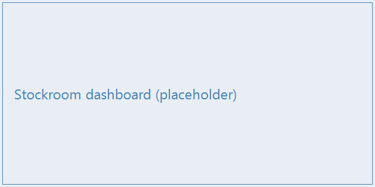

# System Overview

## What the system does {#what-it-does}

Stockroom tracks **every item in the warehouse** from goods receipt to dispatch. A
barcode scanner at each station records movements; the server keeps the stock ledger
and reports the current levels to the dashboard.

One receiving cycle takes approximately **40 seconds** from scan to shelf confirmation.

## Main components {#main-components}

{width=60% align=center widths="28% 72%"}
| Component | Description |
|-----------|-------------|
| Application server | Hosts the web application and the stock ledger |
| Database | Relational store for items, locations, and movements |
| Scanner stations | Handheld barcode scanners at receiving, picking, and dispatch |
| Label printer | Prints shelf and pallet labels on demand |
| Dashboard | Wall display showing stock levels and open tasks |
| Integration service | Exchanges orders and deliveries with the ERP system |

::: audience admin
The service topology, ports, and deployment notes are in the API reference (Administrator
view → API Reference tab). Hostnames and addresses are listed in
[Network and addresses](dw:installation#network).
:::

## Receiving workflow {#receiving-workflow}

:::: group Receiving Steps {#receiving-group desc="Step-by-step goods receipt for user training"}

1. The user scans the delivery note and confirms the supplier.
2. Each item is scanned; the quantity is checked against the order.
3. The system proposes a shelf location; the user confirms it on the scanner.
4. Result OK → item booked in. Mismatch → see the discrepancy procedure.

::: audience user
You only book in a **mismatched delivery** after a supervisor confirms it — the items go
to the quarantine shelf, never directly to picking.
:::

::::
