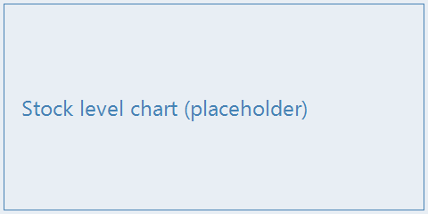

# Security Summary

## Access rules {#access-rules}

Every user signs in with a personal account. Shared logins are not allowed. Scanner
sessions lock after ten minutes without activity (support staff can extend this per
station).

> Security is everyone's responsibility — when in doubt, lock the screen and ask.

::: danger
Never share your password or leave a signed-in scanner unattended. Risk of stock
manipulation.
:::

## Security functions {#security-functions}

{caption="Security functions" widths="25% 35% 40%"}
| Function | Trigger | Reaction |
|----------|---------|----------|
| Session lock | Ten minutes without activity | Screen locks, sign-in required |
| Role check | Action outside the user's role | Action refused, event logged |
| Audit trail | Any stock movement | Movement recorded with user and time |

## Status icons {#status-icons}

| Icon | Meaning |
|------|---------|
| {width=50} | Reference figure (gate fixture — table image alt editing) |

::: audience user
**Never** book a movement on someone else's account. Sign out, then sign in with your
own badge.
:::

::: audience admin
Roles and permissions are managed in the administration console. The audit trail is
retained for **24 months** and exported monthly to the archive share.
:::
