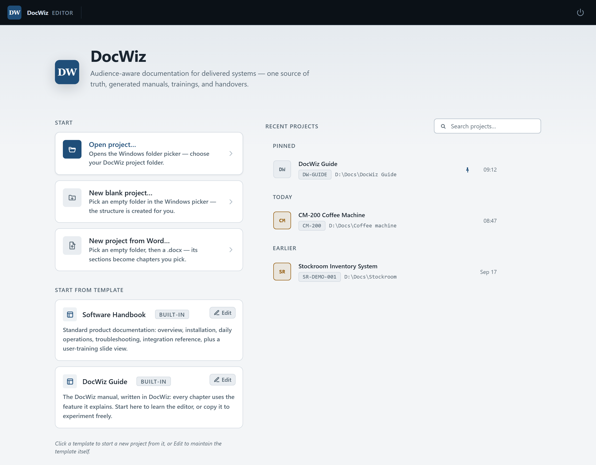

# Your first fifteen minutes

This tour takes you once around the whole circle: open a project, change a page, add a picture, look at the result through one audience's eyes, and build the handover. You work on your own copy of this guide, so nothing you do here can break anything.

## Open your own copy {#open-a-copy}

:::: group Open a copy {#open-a-copy-steps desc="Getting Started deck"}
::: steps
1. Start DocWiz by double-clicking **DocWiz.exe**. The welcome screen opens.
2. Under **Start from template**, click **DocWiz Guide**.
3. Pick an empty folder — for example a new folder called *My DocWiz guide* on your desktop. DocWiz copies the guide into it and opens the copy.
:::
::::

{width=760}

::: tip
Your copy now appears under **Recent projects** on the welcome screen. Click the pin next to it to keep it at the top of the list.
:::

## Change a sentence {#change-a-sentence}

::: steps
1. In the sidebar on the left, click **Welcome to DocWiz**.
2. Click into the first paragraph and type. It works like a word processor: select a word and press **Ctrl+B** for bold or **Ctrl+I** for italic.
3. Watch the top of the page: the status changes to **Saving…** and then to **Saved** with the time. There is no Save button to remember — DocWiz saves two seconds after you stop typing.
:::

## Add a callout {#add-a-callout}

::: steps
1. Click at the end of a paragraph and press **Enter** to start a new line.
2. In the toolbar, open **Insert** and choose **Building block…**.
3. Click **Tip**. A green tip box appears with placeholder text; select the text and type your own.
:::

## Add a picture {#add-a-picture}

Take a screenshot — **Windows+Shift+S** is quickest — then click into the page where the picture belongs and press **Ctrl+V**. DocWiz asks for a file name and a caption and stores the picture in the project for you. Click the picture to change its size or position; [Pictures](dw:pictures) has the details.

## See what one audience sees {#see-one-audience}

::: steps
1. At the top of the window, click **Preview as Everyone** and choose **Trainer**.
2. A banner explains what you are looking at: blocks meant for other readers are hidden, and editing is paused. Chapters that trainers do not get are dimmed in the sidebar.
3. Click **Stop preview** in the banner to get back to editing.
:::

## Build the handover {#build-it}

::: steps
1. Click **Check** at the top right. DocWiz looks for broken links and missing pictures; **No issues ✓** means you are good to go.
2. Click **Build handover**. When it has finished, a **Handover** button appears next to it.
3. Click **Handover** to open the result: the manual with its chapters, and the slide decks and documents as tabs along the top.
:::

::: note What just happened
You changed the manual once. Every slide deck and document that uses the part you changed picked up the change by itself — nothing was copied, so nothing can go out of date.
:::

## Tick off what you tried {#checklist}

In the editor, click a box to tick it.

- [x] Open your own copy of the guide
- [ ] Change a sentence and watch it save
- [ ] Add a tip and a picture
- [ ] Preview the manual as a trainer
- [ ] Build the handover and open it

Ready for more? [The editor at a glance](dw:editor-tour) names every part of the window, and [Building blocks](dw:building-blocks) shows what you can put on a page.
