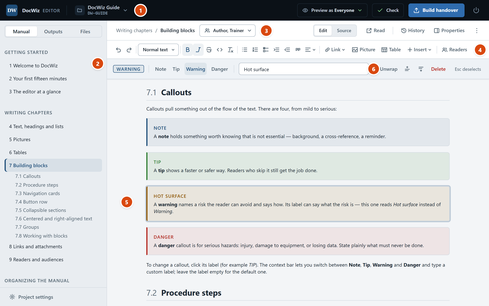

# The editor at a glance

The DocWiz editor looks like a word processor wrapped around the real page: what you type is laid out exactly as readers will see it in the handover. This chapter names the parts of the window, so the rest of the guide can refer to them.

{#editor-overview width=760}

{#editor-areas widths="8% 26% 66%" caption="The parts of the editor window"}
| | Part | What it is for |
|---|------|----------------|
| 1 | Title bar | The project menu (click the project's name), **Preview as**, **Check**, **Build handover**, and the power button that stops the editor |
| 2 | Sidebar | Three tabs — **Manual** (sections and chapters), **Outputs** (slide decks and documents) and **Files** (pictures and attachments) — with **Project settings** at the bottom |
| 3 | Document bar | Where you are (*Section / Title*), who reads this chapter, the save state, and **Edit · Source**, **Read**, **History**, **Properties** and **⋯** |
| 4 | Toolbar | Text formatting, lists, alignment, links, pictures, tables, building blocks and **Readers** |
| 5 | The page | The chapter itself — click anywhere and type |
| 6 | Context bar | Appears when you click a picture, a table or a building block, with the tools for just that thing |

## The project menu {#project-menu}

Click the project's name at the top left to open the project menu:

- **Switch project…** — go back to the welcome screen and open another project.
- **Open project folder** — show the project's folder in Windows Explorer.
- **Import Word document…** — turn a Word file into chapters; see [Importing Word documents](dw:word-import).
- **Export PDF or HTML…** — see [Exporting PDF and HTML](dw:export).
- **Save a copy as…** — copy the whole project to another folder and continue in the copy.
- **Save as template…** — make this project's structure available on the welcome screen; see [Project templates](dw:templates).

When a project contains Word pictures that browsers cannot show, the menu also offers **Convert … Word images to PNG…**.

## The sidebar {#sidebar}

{#sidebar-tabs widths="20% 80%"}
| Tab | What it shows |
|-----|---------------|
| Manual | The sections and chapters in reading order, numbered as in the handover. The open chapter unfolds into its headings — click one to jump there. |
| Outputs | The slide decks and documents built from the manual, each with the audience it is for, and the documentation packages bundled with the handover. |
| Files | The project's pictures (with thumbnails) and attachments. Click one to put it into the page you are editing. |

## The document bar {#document-bar}

The document bar belongs to the chapter you are editing:

- **Section / Title** shows where the chapter sits. The title is the big heading at the top of the page; change it there, or double-click the chapter in the sidebar.
- The **readers** button (for example *All readers*) sets who the chapter is for; see [Readers and audiences](dw:readers).
- The **save state** reads *Saving…* or *Saved* with the time.
- **Edit · Source** switches between the page and the plain text behind it. You will rarely need Source; going back to Edit keeps what you changed there.
- **Read** opens the chapter exactly as the handover shows it, in a new tab.
- **History** shows every saved version of the chapter; see [Saving, undo and history](dw:history).
- **Properties** shows the chapter's section, readers, where it is used, and its link.
- **⋯** renames, moves or deletes the chapter.

## The page and the context bar {#page-and-context-bar}

The page is the chapter itself, drawn with the same layout as the handover: headings are numbered as you type, pictures get their *Figure* captions, and tables their *Table* captions. Click a picture, a table or a building block and its tools appear in the **context bar** under the toolbar; press **Esc** to step out again.

{width=760}

Every selected thing has a **⋯** button at the end of its context bar. It opens the same menu as right-clicking the thing, with every tool spelled out by name.

## Zoom, light and dark {#zoom-and-theme}

- **Ctrl+mouse wheel**, **Ctrl+plus**, **Ctrl+minus** and **Ctrl+0** zoom the page between 50% and 300%. Only the content grows; the bars stay the same size.
- The editor follows the Windows light or dark setting. To choose one yourself, open **Project settings** › **Application** › **Appearance**.
