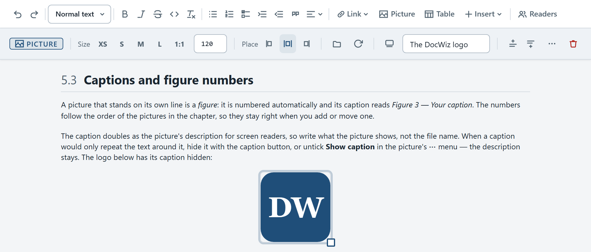

# Pictures

Screenshots and diagrams are what most manuals are made of. DocWiz keeps every picture inside the project, numbers it, and lets you size and place it with a click.

## Three ways to add a picture {#add-a-picture}

**Paste it.** Copy a picture or take a screenshot (**Windows+Shift+S**), click into the page and press **Ctrl+V**. Dragging a picture file onto the page works the same way. DocWiz asks where to keep it:

- **Into folder** — a folder inside the project's pictures, for example *screens*. Leave it empty to keep the picture at the top level; DocWiz remembers your last choice.
- **File name** — what the picture file is called.
- **Caption** — a short description of what the picture shows.

**Insert it from the toolbar.** Click **Picture** (or **Insert** › **Picture…**). The dialog lists every picture already in the project; pick one, or click **Upload new** to add one from your computer. Choose a **Size** and an **Alignment** before you click **OK**.

**Pick it from the Files tab.** In the sidebar, open **Files** and click a picture. The insert dialog opens with that picture already chosen.

::: tip Paste straight from Word
Copying a picture in Word and pasting it into DocWiz works too. The picture is stored as a normal file in the project, so it shows up in every output.
:::

## Size and position {#size-and-position}

Click a picture to select it. The context bar shows its tools:

{#picture-tools width=760}

{widths="22% 78%" caption="Picture tools"}
| Tool | What it does |
|------|--------------|
| Size | **XS**, **S**, **M**, **L** and **1:1** make it 50, 320, 640 or 960 pixels wide, or its original size. Type an exact width into the **px** box, or drag a corner handle — it snaps to the same sizes. |
| Place | Left, centered or right. Centered is the default. |
| Replace… | Swap the picture for another one from the project, or upload a new one — handy when a screen has changed. |
| Rotate | Turns the picture 90° clockwise. |
| Caption | Shows or hides the caption under the picture; the box next to it holds the caption text. |
| ⋯ | Every tool by name, plus **Copy link to this picture** and **Delete picture**. |

Press **Esc** to step out of the picture again.

## Captions and figure numbers {#captions}

A picture that stands on its own line is a *figure*: it is numbered automatically and its caption reads *Figure 3 — Your caption*. The numbers follow the order of the pictures in the chapter, so they stay right when you add or move one.

The caption doubles as the picture's description for screen readers, so write what the picture shows, not the file name. When a caption would only repeat the text around it, hide it with the caption button, or untick **Show caption** in the picture's **⋯** menu — the description stays. The logo below has its caption hidden:

{width=120 .img-center .no-caption}

This one is small and placed on the right, with its caption showing; the caption follows the picture to the right:

{width=50 .img-right}

::: audience admin
Pictures are files in the project's `assets` folder. Rotating a picture rewrites its file; the original is kept in a `_rotated-originals` folder, which is never shipped with the handover.
:::

## Pictures in tables {#pictures-in-tables}

A picture can also sit inside a table cell — useful for icons, symbols and small screenshots next to their explanation. Click into a cell and insert or paste the picture as usual. Pictures in cells have smaller sizes (50, 160, 320 and 640 pixels) and no caption, but you can still give them a description.

{widths="20% 80%"}
| Symbol | Meaning |
|--------|---------|
| {width=50} | The DocWiz icon: double-click it to start the editor. |

## Links to pictures {#links-to-pictures}

Every figure has its own link. Open the picture's **⋯** menu and choose **Copy link to this picture**, then paste the link where you want to refer to it — see [Links and attachments](dw:links).
