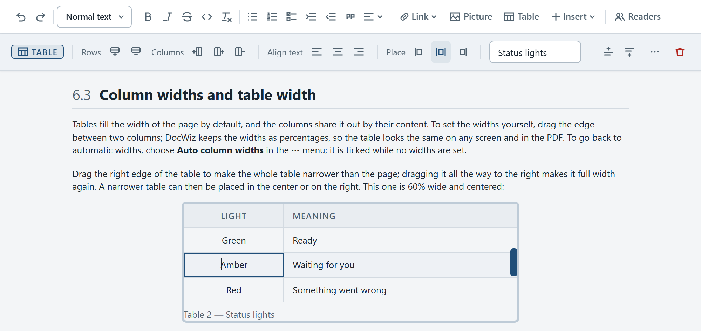

# Tables

Tables carry settings, part lists, error codes and anything else that has rows and columns. DocWiz numbers them, fits them to the page, and lets you set column widths by dragging.

## Insert a table {#insert-a-table}

Click **Table** in the toolbar. A grid opens: move the mouse over it until the readout shows the size you want — for example *3 x 4* — and click. The new table has a header row with *Column 1*, *Column 2* and so on; click a cell and type over them.

{#cell-keys widths="30% 70%" caption="Typing in a table"}
| Key | What it does |
|-----|--------------|
| Tab / Shift+Tab | Go to the next or the previous cell |
| Enter | Finish the cell |
| Shift+Enter | Start a new line inside the cell |
| Esc | Leave the cell and undo what you typed in it |

## Rows, columns and alignment {#rows-and-columns}

Click a table to select it. Its context bar has the tools, in named groups:

{width=760}

- **Rows** — insert a row below the one you are in, or delete it.
- **Columns** — insert a column to the left or right, or delete it.
- **Align text** — left, centered or right for the whole column you are in.
- **Place** — where a narrower table sits on the page: left, centered or right.
- **Caption** — the box for the table's title.

The **⋯** button (or right-clicking the table) offers the same tools by name, plus **Auto column widths**, **Copy link to this table** and **Focus this table**, which spreads the table over the whole editing area so a large one is easier to edit — the page itself is not changed. **Esc** leaves focus again.

## Column widths and table width {#widths}

Tables fill the width of the page by default, and the columns share it out by their content. To set the widths yourself, drag the edge between two columns; DocWiz keeps the widths as percentages, so the table looks the same on any screen and in the PDF. To go back to automatic widths, choose **Auto column widths** in the **⋯** menu; it is ticked while no widths are set.

Drag the right edge of the table to make the whole table narrower than the page; dragging it all the way to the right makes it full width again. A narrower table can then be placed in the center or on the right. This one is 60% wide and centered:

{#signal-table width=60% align=center widths="30% 70%" caption="Status lights"}
| Light | Meaning |
|:-----:|---------|
| Green | Ready |
| Amber | Waiting for you |
| Red | Something went wrong |

## Captions and table numbers {#captions}

Every table is numbered automatically. Type a title into the **Caption** box and it reads *Table 2 — Your title* underneath; leave the box empty and only the number shows. Numbers follow the order of the tables in the chapter.

## Several lines in a cell {#line-breaks}

Press **Shift+Enter** inside a cell to start a new line without starting a new row:

{widths="30% 70%"}
| Step | Details |
|------|---------|
| Before you start | Close all programs. Save your work. Plug in the charger. |
| Afterwards | Restart the computer. |

## Wide tables {#wide-tables}

A table with many columns wraps its text to fit the page. Readers can click the expand button in the corner of any table in the handover to see it full screen at its natural width — this is called the focus view.

::: audience admin
Column widths, the table width, placement and the caption are kept on one line above the table in the chapter's text, for example `{widths="30% 70%" width=60% align=center caption="Status lights"}`. **Check** warns when the number of widths doesn't match the number of columns.
:::
