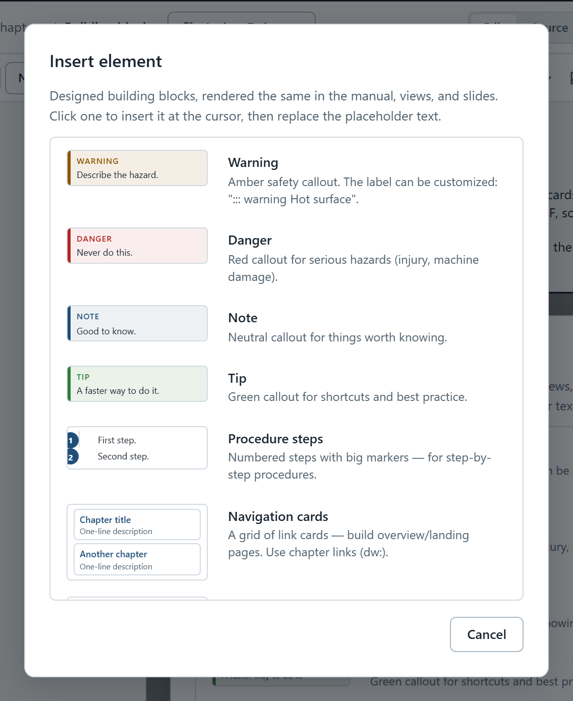

# Building blocks

Building blocks are ready-made, designed elements: callouts, procedure steps, navigation cards, buttons, collapsible sections and alignment boxes. They look the same in the manual, in documents, on slides and in the PDF, so you never have to style anything by hand.

To add one, click where it should go and choose **Insert** › **Building block…**. Click a block in the list and it appears at the cursor, filled with placeholder text for you to replace.

{width=560}

{#block-list widths="28% 72%" caption="The building blocks"}
| Block | Use it for |
|-------|------------|
| Note | Something worth knowing |
| Tip | A faster or safer way to do something |
| Warning | A risk the reader can avoid — the label can be changed |
| Danger | Serious hazards: injury, damage, data loss |
| Procedure steps | Step-by-step instructions with big numbers |
| Navigation cards | A grid of links to chapters, for overview pages |
| Button row | Links shown as buttons, for the next step |
| Collapsible section | Details the reader opens only when needed |
| Centered text, Right-aligned text | Aligning text, tables or pictures |
| Group | Keeping blocks together so a slide can show them |

## Callouts {#callouts}

Callouts pull something out of the flow of the text. There are four, from mild to serious:

::: note
A **note** holds something worth knowing that is not essential — background, a cross-reference, a reminder.
:::

::: tip
A **tip** shows a faster or safer way. Readers who skip it still get the job done.
:::

::: warning Hot surface
A **warning** names a risk the reader can avoid and says how. Its label can say what the risk is — this one reads *Hot surface* instead of *Warning*.
:::

::: danger
A **danger** callout is for serious hazards: injury, damage to equipment, or losing data. State plainly what must never be done.
:::

To change a callout, click its label (for example *TIP*). The context bar lets you switch between **Note**, **Tip**, **Warning** and **Danger** and type a custom label; leave the label empty for the default one.

## Procedure steps {#procedure-steps}

Use **Procedure steps** for anything the reader does in order. The numbers are large, so readers can keep their place while they work:

::: steps
1. Click where the procedure should go.
2. Choose **Insert** › **Building block…** › **Procedure steps**.
3. Replace the placeholder steps with your own; press **Enter** for the next step.
:::

A single step can be meant for one audience only — see [Readers and audiences](dw:readers#tag-a-step).

## Navigation cards {#navigation-cards}

Cards turn a list of chapter links into a grid of tiles — good for the first page of a manual or a section:

::: cards
- [Pictures](dw:pictures) — paste, size and caption screenshots
- [Tables](dw:tables) — widths, captions and pictures in cells
- [Links and attachments](dw:links) — links that survive renaming
:::

Each line is a link followed by a dash and a short description.

## Button row {#button-row}

A button row turns links into buttons — use it to point readers at what to do next:

::: buttons
[Continue with Links](dw:links) [Back to the start](dw:welcome)
:::

## Collapsible sections {#collapsible}

A collapsible section keeps long, rarely needed detail out of the way until the reader asks for it. The first line is its title:

::: details Why are there no fonts or colors to choose?
DocWiz documents all look alike on purpose: a reader who knows one handover can find their way in the next. The design takes care of headings, spacing, colors and dark mode, so authors can concentrate on the content.
:::

## Centered and right-aligned text {#alignment-blocks}

**Centered text** and **Right-aligned text** align everything inside them — paragraphs, tables, even pictures. The alignment menu in the toolbar adds them for you; see [Text, headings and lists](dw:text#alignment).

## Groups {#groups}

A group keeps several blocks together under a name — for example the explanation and the table that belongs to it. Readers never see a group; it exists so that a slide deck or document can show exactly those blocks, kept in sync with the chapter.

::: group Steps and checks {#group-example desc="An example group — used by the Training with DocWiz deck"}
To make a group, select the paragraphs, then choose **Insert** › **Group the selected blocks…** (or right-click the selection and choose **Group selection…**) and give it a name.

The name appears when you pick something to show on a slide. The optional description is a note to yourself; readers never see it.
:::

In the editor, a group shows as a labelled frame so you can see where it starts and ends. Right-click it to rename it, ungroup it (keeping the content) or delete it with its contents.

## Working with blocks {#working-with-blocks}

- **Select a block** by clicking its label. Its tools appear in the context bar.
- **Leave a block** by pressing **Enter** on an empty last line inside it — the cursor moves below the block.
- **Unwrap** removes the block but keeps its text as ordinary paragraphs.
- **Delete** removes the block *and* its content; **Ctrl+Z** brings it back.
- **Add a paragraph above or below** with the two arrow buttons, when a block sits at the very start or end of the page.

::: audience admin
In the chapter's text, every building block is a fenced block such as `::: warning Hot surface` … `:::`. **Check** warns about any block name it doesn't know, which catches typos.
:::
