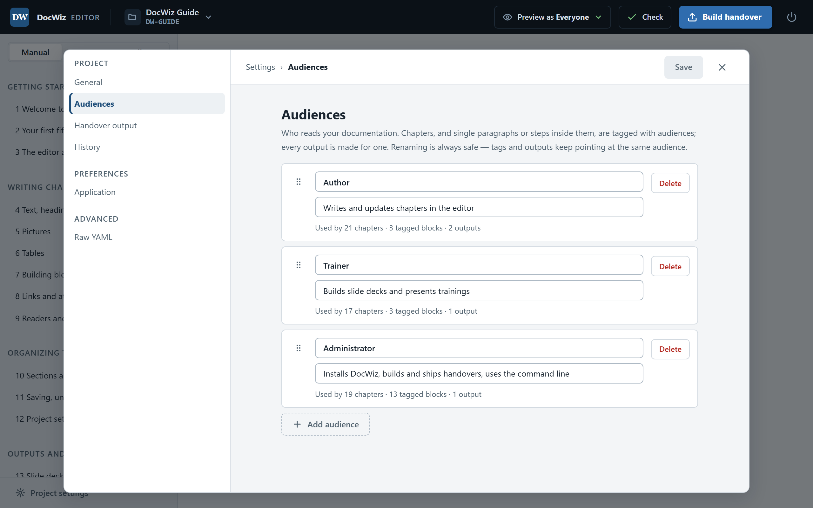
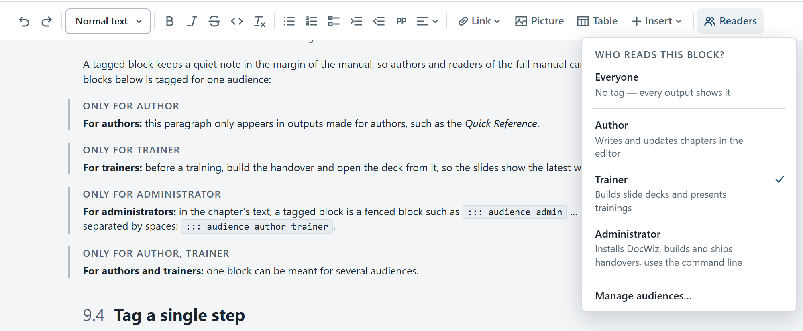
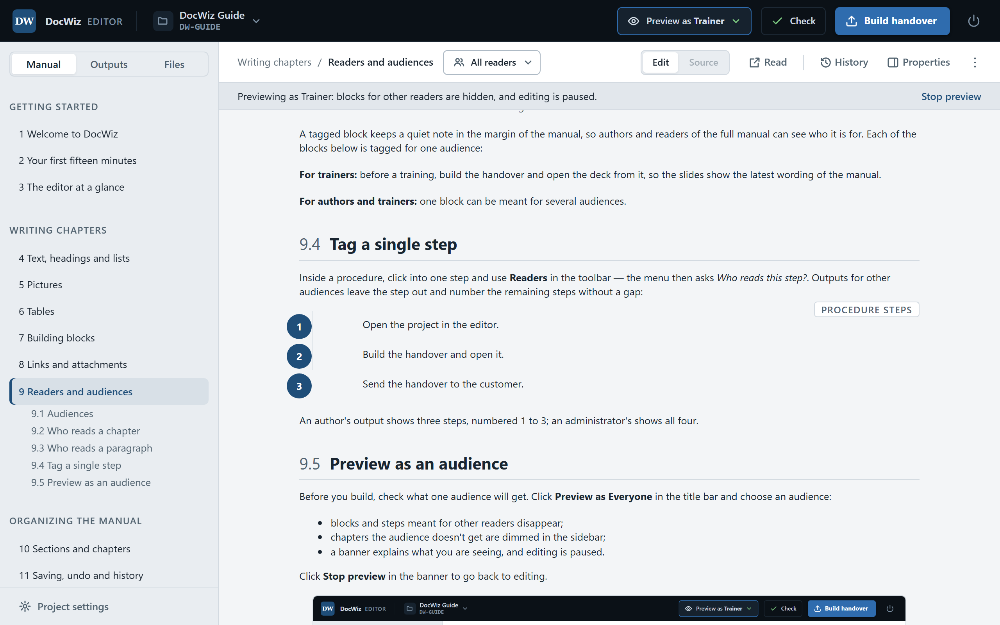

# Readers and audiences

One manual usually serves several kinds of readers. A machine operator needs the steps; the service technician needs the same steps plus the one warning that only concerns them. DocWiz lets you write that procedure once and decide, paragraph by paragraph, who reads what.

## Audiences {#audiences}

An **audience** is a group of readers, such as *User*, *Support* or *Administrator*. Each project defines its own; this guide has *Author*, *Trainer* and *Administrator*. Every output — a slide deck or a document — is made for exactly one audience.

To add, rename, reorder or delete audiences, open **Project settings** › **Audiences**. Each audience has a **Name** and a line describing **who** they are; that line is shown to authors when they pick readers, never to readers. Next to each audience you see how much it is used, for example *Used by 5 chapters · 3 tagged blocks · 1 output*.

{width=760}

Renaming an audience is always safe. Deleting one is refused while an output is still made for it.

## Who reads a chapter {#chapter-readers}

The readers button in the document bar shows who the chapter is for — *All readers*, one or two names, or *No readers*. Click it and tick the audiences, or **Everyone**.

The full manual always contains every chapter. A chapter's readers decide which outputs may use it: **Check** warns when a slide deck for trainers shows a chapter that is not for trainers, and **Preview as** dims the chapters an audience doesn't get.

## Who reads a paragraph {#block-readers}

Click into a paragraph, a list or a building block and click **Readers** in the toolbar. Tick the audiences who should see it; **Everyone** removes the tag again.

{width=760}

A tagged block keeps a quiet note in the margin of the manual, so authors and readers of the full manual can see who it is for. Each of the blocks below is tagged for one audience:

::: audience author
**For authors:** this paragraph only appears in outputs made for authors, such as the *Quick Reference*.
:::

::: audience trainer
**For trainers:** before a training, build the handover and open the deck from it, so the slides show the latest wording of the manual.
:::

::: audience admin
**For administrators:** in the chapter's text, a tagged block is a fenced block such as `::: audience admin` … `:::`. Several audiences are separated by spaces: `::: audience author trainer`.
:::

::: audience author trainer
**For authors and trainers:** one block can be meant for several audiences.
:::

## Tag a single step {#tag-a-step}

Inside a procedure, click into one step and use **Readers** in the toolbar — the menu then asks *Who reads this step?*. Outputs for other audiences leave the step out and number the remaining steps without a gap:

:::: steps
1. Open the project in the editor.
2. ::: audience admin
   Copy the project folder to the file share where the team keeps its projects.
   :::
3. Build the handover and open it.
4. Send the handover to the customer.
::::

An author's output shows three steps, numbered 1 to 3; an administrator's shows all four.

## Preview as an audience {#preview-as}

Before you build, check what one audience will get. Click **Preview as Everyone** in the title bar and choose an audience:

- blocks and steps meant for other readers disappear;
- chapters the audience doesn't get are dimmed in the sidebar;
- a banner explains what you are seeing, and editing is paused.

Click **Stop preview** in the banner to go back to editing.

{width=760}

::: tip Playlists first, tags second
Most of an output is chosen by *what it shows*: a training deck shows the sections it needs and nothing else. Use reader tags for the remaining cases — a shared procedure with one step or one warning for some readers only.
:::
