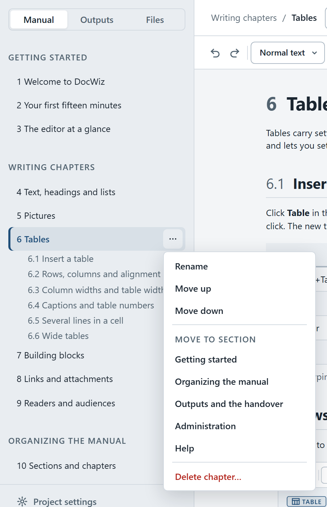
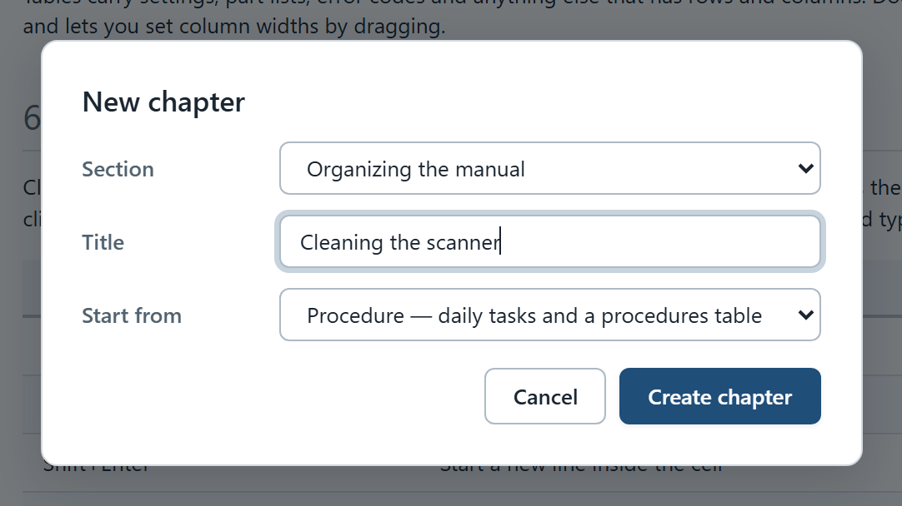

# Sections and chapters

A DocWiz manual is made of **sections**, and each section holds **chapters**. The sidebar's **Manual** tab shows them in reading order, numbered as in the handover. Everything you do there — adding, renaming, moving, deleting — happens right away, and **Ctrl+Z** undoes it.

{width=420}

## Add a section {#add-a-section}

Click **+ New section** at the bottom of the chapter list and type a name. Any name works — accents, spaces and capitals included — except the characters `\ / : * ? " < > |`, which Windows doesn't allow in folder names.

A new section is empty. It stays in the sidebar, with a *No chapters yet — add one* button, until you add a chapter or delete it.

## Add a chapter {#add-a-chapter}

Click the **+** next to a section's name, or **Add a chapter here** in its **⋯** menu. The **New chapter** dialog asks for:

- **Section** — where the chapter goes; choose *— new section —* to create one on the way.
- **Title** — the chapter's heading, for example *Cleaning the scanner*.
- **Start from** — an empty page, or a ready-made outline to fill in:

{#start-from widths="28% 72%" caption="Start from"}
| Start from | You get |
|------------|---------|
| Blank page | Just the title |
| Overview | A purpose and scope section |
| Installation | Requirements, installation steps and configuration |
| Procedure | Daily tasks and a table of procedures |
| Troubleshooting | A table of symptoms, causes and actions, and where to get help |
| Reference | An overview and a details table |
| Integration | Endpoints and data exchange |

{width=560}

## Rename {#rename}

Double-click a section or a chapter in the sidebar and type the new name; **Enter** keeps it, **Esc** cancels. A chapter's title is the heading at the top of its page, so you can also simply edit that heading.

## Move and reorder {#move}

- **Drag** a chapter onto another chapter to put it before that one, or onto a section's name to put it at the end of that section.
- Use **Move up** and **Move down** in the chapter's or the section's **⋯** menu.
- Pick another section under **Move to section** in the chapter's **⋯** menu — or change **Section** in the chapter's **Properties**.

Chapter and heading numbers follow the new order immediately, everywhere.

## Delete {#delete}

Choose **Delete chapter…** in the chapter's **⋯** menu. The chapter moves to *Recently deleted* in [History](dw:history#recently-deleted), and **Ctrl+Z** brings it straight back. If another chapter or an output still links to it, DocWiz refuses and tells you where, so nothing ends up broken.

A section can only be deleted when it is empty: move its chapters elsewhere first, then choose **Delete section…**.

## Properties {#properties}

Click **Properties** in the document bar for the facts about the open chapter:

- **Section** — change it to move the chapter.
- **Readers** — who the chapter is for, with a **Change** link.
- **Used in** — the outputs that show it (with slide numbers) and the chapters that link to it. Check this before you rewrite a chapter that a training depends on.
- **Link ID** — the chapter's permanent link, with **Copy link**.
- **File** — where the chapter lives in the project folder.

## Numbering {#numbering}

Chapters are numbered 1, 2, 3 … straight through the manual; sections are headings in the sidebar and are not numbered. Inside a chapter, headings continue the chapter's number: 4.1, 4.2, 4.2.1. To switch numbering off for a whole project, open **Project settings** › **Handover output** and turn **Automatic numbering** off.

::: audience admin
Each section is a folder under `content`, and each chapter a Markdown file in it. The folder is named after the section and the file after the chapter title, each with a number in front that keeps the order — for example `020-Writing chapters/030-Tables.md`. The editor renames and renumbers these for you; links use the chapter's ID, so file names never matter. See [The project folder](dw:project-folder).
:::
