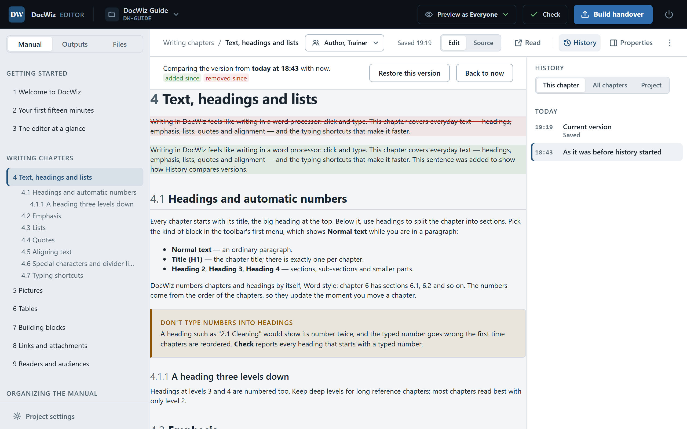

# Saving, undo and history

DocWiz saves as you work and keeps every saved version, so you can always go back — to a minute ago with **Ctrl+Z**, or to last month with **History**.

## Saving happens by itself {#autosave}

There is no Save button to forget. DocWiz saves the chapter or output you are editing:

- two seconds after you stop typing;
- before you open another chapter, output or screen;
- when you switch to another window.

The document bar shows **Saving…** and then **Saved** with the time. While you are typing in a table cell or working in **Source**, saving waits until you are done. If you like to save by hand, **Ctrl+S** saves immediately.

::: note Working together
Two people should not edit the same chapter at the same time. If a chapter was changed on disk by someone else after you opened it, DocWiz refuses to overwrite it and asks you to reload the chapter first.
:::

## Undo and redo {#undo}

**Ctrl+Z** undoes your last change and **Ctrl+Y** redoes it; the arrows at the left of the toolbar do the same. Undo covers the page *and* the sidebar in one order, newest first: typing, a renamed chapter, a moved section, a deleted chapter. Changes in the sidebar also show a short message with an **Undo** link.

## The history of a chapter {#chapter-history}

Click **History** in the document bar. The **This chapter** tab lists the saved versions of the chapter by day, newest first — *Saved*, *Renamed*, *Restored …*. Saves made within ten minutes of each other are kept together as one version.

{width=760}

Click a version to compare it with now: added text is marked green, removed text red, and notes tell you when the title or the readers were different. Then:

- **Restore this version** puts the chapter back the way it was. Restoring is itself a change, so it can be undone too.
- **Back to now** closes the comparison.

The **All chapters** tab lists every saved change in the project, newest first — handy for seeing what changed since the last handover. Click a row to open that chapter and compare.

## Named versions {#named-versions}

A named version is a snapshot of the whole project — every chapter and output — under a name you choose, such as *Handover to customer 1.0*. On the **Project** tab of **History**, click **Mark a version…**. After a successful **Build handover**, DocWiz offers the same with one click.

**Restore…** next to a named version puts the whole project back the way it was; the state just before is kept as a version of its own, so nothing is lost. Pictures and attachments are not affected. Named versions are kept until you delete them.

::: tip
Mark a version every time you send a handover to a customer. When they call with a question months later, you can see exactly what they have.
:::

## Recently deleted {#recently-deleted}

Deleted chapters, outputs and attachments wait under **Recently deleted** on the **Project** tab. Click **Restore** to bring one back.

## Cleaning up {#clean-up}

History grows slowly, but it grows. **Project settings** › **History** shows how much space it uses and removes entries older than 30 days, 90 days or a year. Named versions are always kept.

::: audience admin
History lives in the project's `.docwiz` folder: one complete copy of a file per version, so deleting any part of it — or the whole folder — breaks nothing. It is excluded from git, from **Save as template** and from **Save a copy as…**, and never shipped with the handover.
:::
