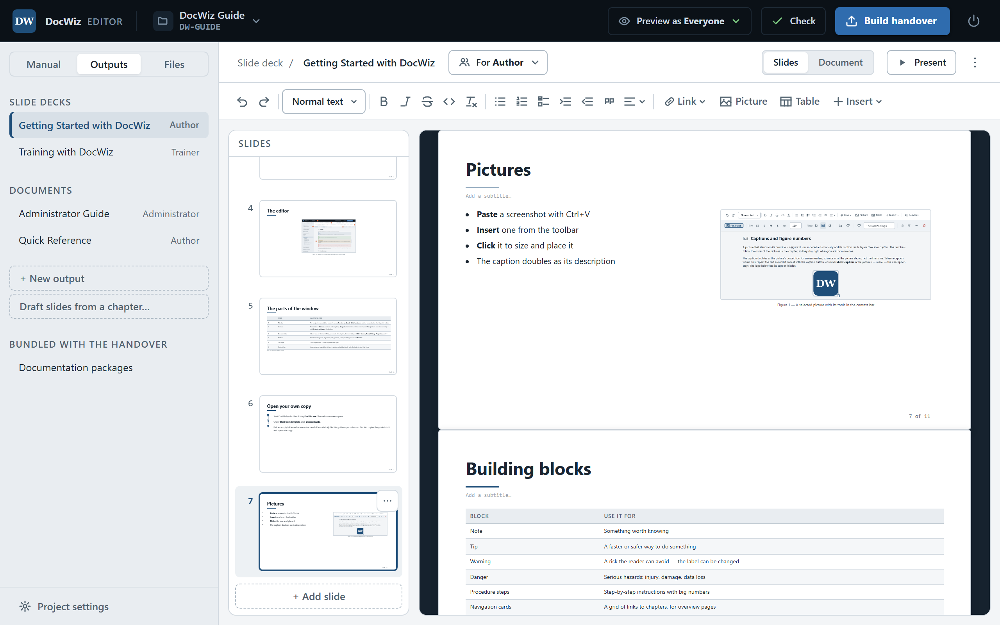

# Slide decks

A slide deck in DocWiz is a training presentation built from the manual. Its slides show sections of the chapters — kept in sync with them — plus a little text of their own: a title, an agenda, a "Questions?" at the end. When the manual changes, the deck changes with it; nobody rebuilds slides by hand again.

This guide comes with two decks: **Getting Started** for authors and **Training with DocWiz** for trainers. Open them from the **Outputs** tab to see how they are made.

## Create a deck {#create-a-deck}

::: steps
1. In the sidebar, open the **Outputs** tab and click **+ New output**.
2. Type a **Title**, for example *Operator training*. It becomes the first slide and the deck's tab in the handover.
3. Under **For**, choose the audience the training is for.
4. Under **Kind**, choose **Slide deck (a presentation)** and click **Create output**.
:::

Already have a good deck? Open its **⋯** menu and choose **Duplicate…** — the copy has all the slides and becomes the start of the next training. For the next customer, only the content of the manual changes; the training's structure stays.

{#slide-deck-editor width=760}

## The output bar {#output-bar}

The bar above a deck holds its title (click to edit it), **For** with its audience, the save state, and:

- **Slides · Document** — switch the output between a slide deck and a document;
- **Present** — save and open the deck as a presentation in a new tab;
- **⋯** — **Duplicate…**, **Export as one HTML file** and **Delete output…**.

## Slides {#slides}

The column on the left shows a miniature of every slide. The first is the title slide; DocWiz makes it from the deck's title and the project's name and code, so it needs no work.

- Click a miniature to edit that slide; drag it up or down to reorder.
- Click the **+** between two slides to add one there, or **+ Add slide** at the bottom.
- A slide's **⋯** menu moves it up or down, changes its **Layout**, or deletes it.

Each slide has a layout:

{#slide-layouts widths="25% 75%" caption="Slide layouts"}
| Layout | Use it for |
|--------|------------|
| Title + content | The everyday slide: a heading and one area for content |
| Two columns | Side by side — text next to a picture, before and after, do and don't |
| Big media | One large picture or screenshot filling the slide |
| Section header | A divider between parts of the training: big title and subtitle, no content |

You can change a slide's layout at any time. Content in an area the new layout doesn't have moves into its first free area. A section header has no areas at all, so DocWiz asks before it lets content go.

## Write on a slide {#write-on-a-slide}

Click a slide's title, subtitle or content area and type. The toolbar works as in chapters. Inside a content area, type **/** at the start of a line for a quick menu: headings, lists, a quote, a picture, or a linked section.

Keep your own text on slides short — an agenda, a question to the group, a summary. Everything that explains *how* belongs in the manual, where it is written once and kept up to date.

## Show a section of the manual {#linked-sections}

A **linked section** shows a part of a chapter on the slide — a section under a heading, a whole chapter, a group of blocks, a table or a picture. It is not a copy: when the chapter changes, the slide shows the new version the next time it is opened or built.

::: steps
1. Click into an empty line in the slide's content area.
2. Type **/** and choose **Linked section**.
3. Pick the **Chapter** and, if you want only part of it, the **Section** — groups are listed at the end.
:::

::: tip From the toolbar
**Insert** › **Linked section…** in the toolbar does the same. On an empty line the linked section takes the line's place; anywhere else it goes below the block the cursor is in, so your text stays.
:::

A linked section on a slide carries a *LINKED* label. Click it for its tools:

- **Edit source** — open the chapter it comes from, to change the original;
- **Change source** — show a different chapter or section instead;
- **Detach** — turn it into your own copy, which no longer follows the chapter;
- **Place** and the right-hand edge — make it narrower and put it left, centered or right. The content reflows to the new width rather than shrinking.

::: tip Make a group for slides
To put just a few paragraphs of a chapter on a slide, wrap them in a group in the chapter (see [Groups](dw:building-blocks#groups)) and link the group.
:::

## Draft a deck from a chapter {#draft-a-deck}

**Draft slides from a chapter…**, on the **Outputs** tab, makes a starting deck from one chapter: a section header from the chapter's title, then one slide per section, each linked to the manual. Delete the slides you don't need, add your agenda and questions, and the training is ready.

## Present {#present}

Click **Present** in the output bar, or open the deck's tab in the handover. The slides fill the window:

{#presenting-keys widths="45% 55%" caption="Presenting"}
| Key | What it does |
|-----|--------------|
| → , Page Down or Space | Next slide |
| ← or Page Up | Previous slide |
| F | Full screen on or off |
| Esc | Leave full screen |

A slide with more content than fits is continued on extra slides marked *(cont.)*; content that still doesn't fit is scaled down. Two-column slides are never split, so keep them short.

::: audience trainer
For a training, build the handover first and present from its tab: the deck then works without the editor, on any computer with a browser — even without a network.
:::
