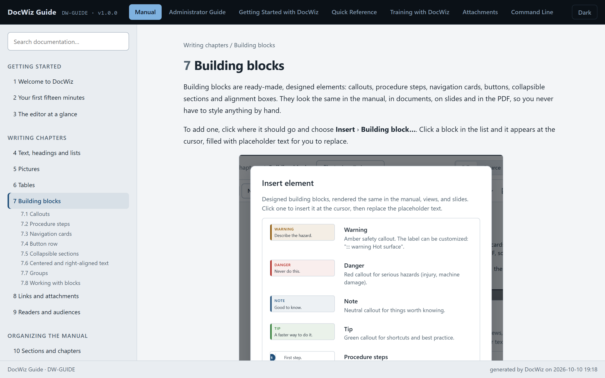
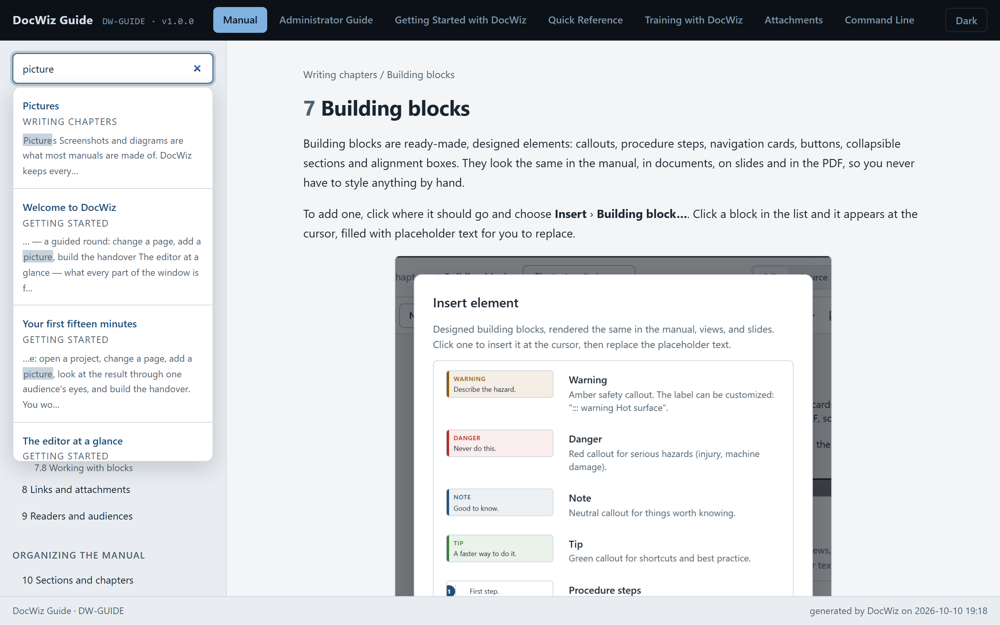

# Building the handover

The **handover** is what your readers get: the full manual, every slide deck and document, the attachments and the documentation packages, all in one folder of web pages. It opens in any modern browser, needs no internet and nothing installed.

## Check first {#check}

Click **Check** in the title bar. DocWiz goes through the whole project and lists what it finds:

- **Errors** stop the build: a link to a chapter or section that doesn't exist, an output that shows a missing section, an audience that isn't defined.
- **Warnings** don't: a picture that isn't there yet (the handover shows a placeholder box instead), a heading with a typed number, an output that shows a chapter not meant for its audience.

**No issues ✓** means everything is in order. [Check messages](dw:check-messages) explains the common messages and what to do about them.

## Build {#build}

Click **Build handover**. DocWiz saves what you are editing, checks the project and builds. When it succeeds:

- the message *Handover built* offers to keep this state as a named version — click it before you send the handover to a customer;
- **Handover** opens the result in a new tab;
- **Download .zip** packs the handover into a single file, ready to send.

## What readers get {#what-readers-get}

{width=760}

- **Tabs** along the top: the **Manual**, every slide deck and document, **Attachments** (when the project has any) and each documentation package.
- **The contents** in the sidebar, by section, with the open chapter's headings — and a home page with the project details and the full table of contents.
- **Search**: type at least two letters into *Search documentation…* in the sidebar. Results show the matching chapters and sections with the words highlighted; **Esc** clears the search.
- **Previous and next** links at the bottom of each chapter.
- **Focus view**: the expand button in the corner of every picture and table opens it full screen. Zoom a picture with the mouse wheel or by clicking, and drag to move around; **Esc** closes.
- **Zoom**: **Ctrl+mouse wheel** or **Ctrl+plus** and **Ctrl+minus** make the text larger or smaller; **Ctrl+0** resets.
- **Light and dark**: the button in the header switches, and the choice is remembered.
- **Only for …** notes in the margin of the manual, where a block is meant for some readers only.

{width=760}

## Send it {#send-it}

The handover is a folder with one web page named after the project and a `_site` folder next to it. Readers open the web page; everything else is in `_site`. Keep the two together:

- zip it with **Download .zip** and send the file, or
- copy the folder to a file share or a USB stick.

To read it, the receiver unzips the folder (if zipped) and double-clicks the page named after the project. It works in Microsoft Edge and Google Chrome without a network connection.

::: warning Building replaces the old handover
Every build deletes the previous handover folder and writes a new one. Never keep your own files in it.
:::

::: audience admin
The handover is built into the project's `output\handover` folder; **Download .zip** writes the zip next to it, named after the project code and version. On the command line, `docwiz build <project> --zip` does the same — see [The command line](dw:command-line).
:::
