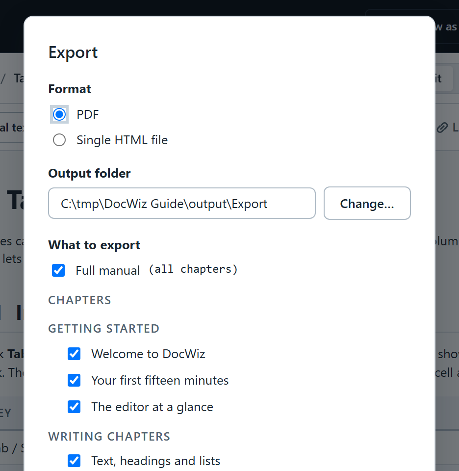

# Exporting PDF and HTML

Sometimes a folder of web pages is not what is asked for: a contract wants a PDF, a colleague wants one file to open. DocWiz exports the manual, single chapters and outputs as PDF files or as single, self-contained web pages.

## Export {#export-dialog}

::: steps
1. Click the project's name in the title bar and choose **Export PDF or HTML…**.
2. Choose the **Format**: **PDF** or **Single HTML file**.
3. Check the **Output folder**. It is the project's *output\Export* folder unless you pick another with **Change…**.
4. Under **What to export**, tick what you need: the **Full manual**, single **Chapters** (grouped by section), and any of the slide decks and documents.
5. Click **OK**.
:::

{width=480}

The export runs in the background — keep working. When it is done, a message says how many files were written; click it to open the folder.

## What the PDF looks like {#pdf}

- **The manual** is A4, with a cover showing the project's name, code, customer and version, every chapter starting on a new page, *Page X of Y* in the footer, and bookmarks for every heading.
- **Chapters** you tick are exported together as one PDF, in the order of the manual.
- **Slide decks** become one wide page per slide, including the title slide and any *(cont.)* slides.
- **Documents** become portrait pages.

PDFs always use the light design, whatever the editor shows. Attached PDFs cannot be put inside another PDF, so a link to an attachment becomes a note naming the attachment.

## Single HTML files {#single-html}

A single HTML file holds everything — text, pictures, design — in one file that opens in any browser. It is ideal for e-mailing one chapter or one document. Search and attached PDFs are not included.

To export one output as a single file, you can also open it on the **Outputs** tab and choose **⋯** › **Export as one HTML file**.

::: audience admin
PDF export uses Microsoft Edge, which comes with Windows; without it DocWiz reports that Edge was not found. On the command line, `docwiz export-pdf <project> --all` exports the manual and every output as PDF — see [The command line](dw:command-line).
:::
